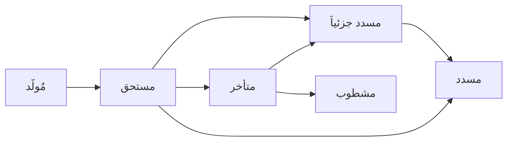
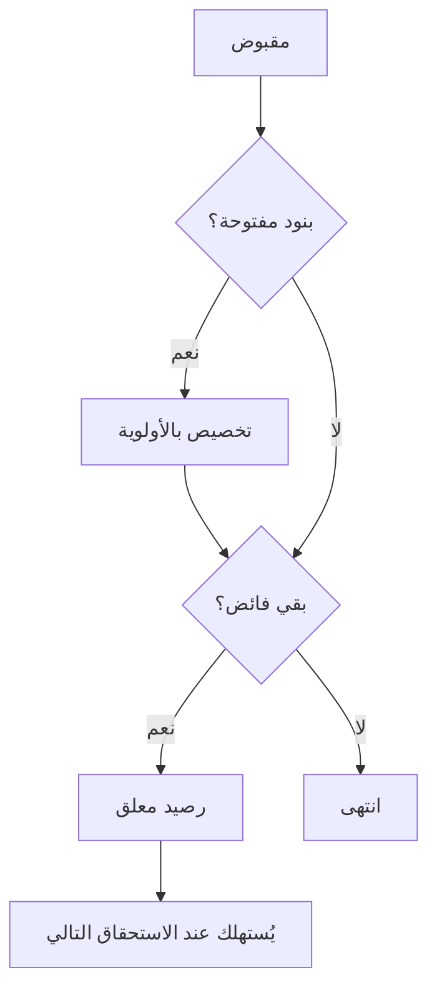
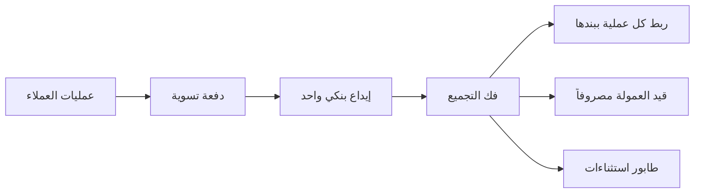
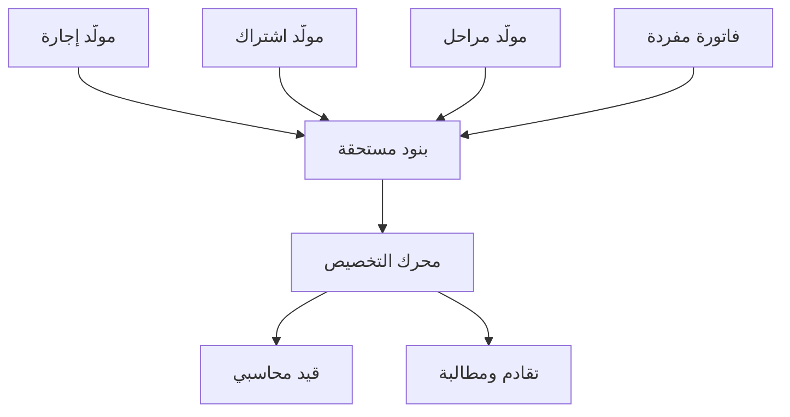

# أنظمة الدفعات والمستحقات: مرجع تصميمي لمنصة رِكز

2026-09-17

## نطاق المرجع وحدوده

هذا مرجع قرار لطبقة الدفعات والمستحقات في منصة محاسبية متعددة الأنشطة والمستأجرين، لا مرجع تعليمي. كل طبقة تعرض المشكلة، ثم البدائل، ثم الترجيح مع حجته.

لا يوجد حصر نهائي لأنظمة المستحقات، لأن كل معيار محاسبي وكل نظام ضريبي يولّد متطلباً جديداً. المعيار المستخدم هنا للإدراج: ما يُبنى مرة واحدة ويصعب تغييره لاحقاً. تُرك عمداً: واجهة المستخدم، وتقارير الإدارة، وكل ما يمكن إضافته لاحقاً دون مساس ببنية القيد.

المرجع العملي الذي بُني عليه هذا المستند عقد تأجير تمويلي حقيقي وكشف حسابه، ظهر فيه خلل تصميمي نموذجي: النظام أعلن تأخر خمسة أشهر على عميل كان يسدد مقدماً في أغلب الشهور. هذا الخلل يتكرر في كل نظام يخلط بين التأخر الزمني والتأخر المبلغي، ويُشار إليه في مواضعه.

## الطبقة الأولى: بنية المستحقات

القرار الأساس هنا: البنود المفتوحة، لا الرصيد المرحّل. التحول من رصيد مرحّل إلى بنود مفتوحة لاحقاً مستحيل عملياً لأن التاريخ لا يمكن تفكيكه، بينما العكس سهل.

**Open Item مقابل Balance Forward**

| الوجه | بنود مفتوحة | رصيد مرحّل |
| --- | --- | --- |
| التمثيل | كل التزام سطر مستقل حتى يُسدد | رصيد واحد يُرحَّل شهرياً |
| الإجابة على "وين راحت فلوسي" | ممكنة بدقة | مستحيلة |
| التقادم والمطالبة | مباشر | تقديري |
| حجم البيانات | أكبر | أصغر |
| يصلح لـ | العقود والأقساط والآجل | التجزئة النقدية البحتة |

**ثلاث طبقات منفصلة لا يجوز خلطها**

1. مولّد الجدول: يُنتج الاستحقاقات مرة واحدة عند إنشاء العقد. منطقه يختلف جذرياً بين إجارة واشتراك ومقاولة، ولذلك يقع خارج المحرك.
2. البنود المستحقة: مخرج موحد الشكل مهما اختلف المولّد. المحرك لا يعرف من أين جاء البند.
3. المحرك: يستهلك البنود ولا يولّدها.

**حقول البند الحرجة:** المبلغ المستحق، والمبلغ المخصص، وتاريخ الاستحقاق، ونوع المكوّن (أصل، ربح، تأمين، ضريبة، رسوم). الرصيد يُشتق ولا يُخزَّن مستقلاً، وإلا انحرف عن مجموع التخصيصات.

**تفكيك المكوّنات إلزامي.** بند القسط الواحد في عقد الإجارة يحمل أربعة مكوّنات لكل منها معالجة ضريبية ومحاسبية مختلفة. دمجها في مبلغ واحد يجعل احتساب الضريبة والاعتراف بالإيراد مستحيلاً لاحقاً.

**دورة حياة البند**

الانتقال إلى متأخر يُحسب ولا يُخزَّن كحالة ثابتة، لأنه دالة في تاريخ اليوم وسماحية النشاط.

## الطبقة الثانية: محرك التخصيص

الدفعة لا تُربط بشهر، بل تدخل كمقبوض مستقل ثم تُوزَّع على بنود مفتوحة. جدول `payment_allocations` يربط كل ريال من كل سند ببند مستحق محدد، وهو ما يجعل السؤال "وين راحت فلوسي" قابلاً للإجابة في ثانية.

**مدارس ترتيب التخصيص**

| المدرسة | القاعدة | الاستخدام | الخطر |
| --- | --- | --- | --- |
| FIFO | الأقدم استحقاقاً أولاً | الافتراضي الأسلم قانونياً | يخفي نزاعاً على فاتورة معينة |
| Specific | العميل يحدد البند | المبيعات الآجلة B2B | يعطّل التقادم إن أُسيء |
| Proportional | توزيع نسبي على كل المفتوح | نادر | يترك كل البنود مفتوحة جزئياً |

**ترتيب الأولوية داخل البند الواحد.** هذا أدق من ترتيب البنود، ويُضبط لكل نوع مستند: الضريبة والرسوم، ثم المتأخرات، ثم القسط الحالي، ثم الفائض. عقد الإجارة المرجعي يطبق هذا حرفياً، ولذلك من دفع 1,449 ريالاً بالضبط ظهر عليه نقص، لأن ضريبة التأمين أُخذت أولاً.

**مسار الدفعة**

**معالجة الفائض، وهي أكثر ما يُساء فهمه من العملاء**

| الخيار | الأثر | متى يصلح |
| --- | --- | --- |
| رصيد معلق | يُستهلك في الاستحقاق التالي، ولا يغيّر الإجمالي | الافتراضي |
| خصم من الأصل | يقلل الربح ويعيد توليد الجدول | بطلب صريح وبشروط العقد |
| رد للعميل | خروج نقدي | عند انتهاء العلاقة |

الفائض الذي يقل عن قسط كامل يبقى معلقاً ولا يُعلن الشهر مسدداً. هذا صحيح محاسبياً لكنه يُربك العميل، والعلاج عرضي لا بنيوي: يُظهر الكشف سطر الرصيد المعلق صراحة.

**قاعدة الانعكاس، وهي مقياس القبول الوحيد غير القابل للتفاوض:** مجموع التخصيصات لكل سند يساوي قيمة السند، ومجموع التخصيصات لكل بند يساوي المسدد منه. أي انحراف بهللة واحدة يوقف الإقفال.

**عكس التخصيص.** عند الارتداد أو الإلغاء يُعكس التخصيص ولا يُحذف، فتعود البنود مفتوحة بأثر مؤرخ. الحذف يفسد التدقيق ويجعل التقادم التاريخي غير قابل لإعادة الإنتاج.

## الطبقة الثالثة: توزيع الربح والاعتراف بالإيراد

التمييز الحاسم: **جدول التحصيل غير جدول الإيراد**. القسط ثابت للعميل، لكن ما يُعترف به إيراداً يتغير شهرياً. خلطهما يجعل القوائم المالية غير مطابقة للمعايير.

**طرق توزيع الربح**

| الطريقة | التوزيع | الحكم |
| --- | --- | --- |
| الخط المستقيم | الربح بالتساوي على الشهور | بسيطة، تخالف IFRS في التمويل |
| الفائدة الفعلية (IFRS 9) | حسب الرصيد المتناقص | المعيار المعتمد |
| قاعدة 78 | معظم الربح مقدماً بتسارع | مرفوضة رقابياً في أنظمة كثيرة |

العقد المرجعي يطبق الفائدة الفعلية داخلياً: جزء كلفة الأجل يبدأ 651.39 وينتهي 358.28 رغم ثبات القسط عند 1,449. هذا هو السلوك الصحيح.

**فخ المعدل الثابت.** كلفة 10% سنوياً على أصل التمويل كامله تُنتج معدل نسبة سنوية فعلياً 23.17%. المنصة يجب أن تحسب وتعرض معدل النسبة السنوية إلى جانب النسبة المعلنة، لأن الإفصاح عنه مطلب نظامي وليس تحسيناً اختيارياً.

**الاعتراف بالإيراد (IFRS 15)**

الإيراد يُعترف به عند أداء الالتزام لا عند القبض. عملياً: كل مقبوض مقدماً يذهب إلى حساب إيراد مؤجل في المطلوبات، ثم يُحرَّر شهرياً إلى الإيراد. هذا يمس كل أنشطتك ذات التحصيل المقدم: الإيجارات، والاشتراكات، والصيانة السنوية.

**نماذج توليد الاستحقاق**

| النموذج | الاستحقاق يقع عند | النشاط |
| --- | --- | --- |
| زمني | مرور المدة | الإيجار والاشتراكات |
| Milestone Billing | إنجاز مرحلة متفق عليها | المقاولات والمشاريع |
| Progress Billing | نسبة الإنجاز المقيسة | العقود طويلة الأجل |
| عند التسليم | نقل السيطرة | البيع والتجزئة |
| الاستهلاك | القراءة الفعلية | الخدمات المقننة |

هذه النماذج الخمسة كلها مولّدات جداول، ومخرجها واحد: بنود مفتوحة. لذلك تتعدد المولّدات ولا يتعدد المحرك.

**التكاليف الإضافية.** رسوم الإصدار والعمولات تُطفأ على مدة العقد ولا تُعترف دفعة واحدة، وتدخل ضمن حساب المعدل الفعلي. الرسوم الإدارية في العقد المرجعي (634 ريالاً) عولجت كتحصيل فوري، وهي معالجة شائعة لكنها ليست الأدق معيارياً.

## الطبقة الرابعة: التحصيل والمطالبة

المطالبة محرك قواعد قابل للضبط، لا شيفرة صلبة، لأن كل نشاط من الأنشطة له مواعيده وإلزاماته النظامية.

**Dunning (المطالبة المتدرجة)**

| المستوى | التوقيت | الإجراء |
| --- | --- | --- |
| تذكير | قبل الاستحقاق | رسالة، بلا أثر مالي |
| إشعار تأخر | بعد السماحية | إشعار موثق |
| إنذار تعثر | بعد مدة محددة | إشعار رسمي بمهلة تصحيح |
| تصعيد | بعد انتهاء المهلة | إجراء نظامي |

العقد المرجعي يلزم بتذكير قبل خمسة أيام من الاستحقاق (المادة 14-2)، وبإشعار تأخر خلال سبعة أيام (المادة 15-2)، وبمهلة تصحيح قبل أي إجراء تنفيذي (المادة 15-4). أي منصة تخدم التمويل يجب أن توثّق إرسال كل إشعار بختم زمني، لأن الإشعار غير الموثق يُسقط الحق في التصعيد.

**المؤشران المنفصلان.** التأخر الزمني يقيس أيام التجاوز، والتأخر المبلغي يقيس صافي الفجوة. دمجهما في مؤشر واحد هو سبب الخلل في الكشف المرجعي، حيث ظهر "متأخر 5 أشهر" على حساب صافيه مسدد. اعرض الاثنين دائماً.

**آليات التحصيل**

| الآلية | الطبيعة | ما تحتاجه المنصة |
| --- | --- | --- |
| الخصم المباشر | تفويض مسبق | إدارة التفويضات وانتهاءها |
| الأمر الدائم | يبدؤه العميل | لا تحكم، مطابقة فقط |
| الفوترة المتجددة | توليد دوري تلقائي | جدولة وإعادة محاولة |
| البطاقة المحفوظة | رمز لا رقم | امتثال PCI، ولا تخزن رقماً |
| سداد | مرجع سداد لكل فاتورة | ربط المرجع بالبند |

**الارتداد (Chargeback).** يستلزم عكس التخصيص وإعادة فتح البنود ورسوماً محتملة. صمّمه من اليوم الأول، لأن إضافته لاحقاً تعني تعديل كل تقرير تاريخي.

**السقف الائتماني.** يوقف البيع الآجل عند تجاوز حد. يحتاج حساب تعرّض لحظي يشمل غير المفوتر، لا الرصيد المفوتر فقط.

## الطبقة الخامسة: المطابقة والقيد والإقفال

**من الحدث إلى القيد**

الأستاذ المساعد يحمل التفصيل بالعميل والبند، والعام يحمل المجاميع. مطابقتهما يومياً شرط، وأي فرق بينهما يعني خللاً في الترحيل لا في البيانات.

**المطابقة الثلاثية.** البند المستحق، والمقبوض المسجل، والحركة البنكية. الثلاثة يجب أن تتطابق، وما لا يتطابق يذهب إلى طابور استثناءات بشري لا إلى تجاهل صامت.

**مطابقة بوابات الدفع.** البوابة تحوّل مبلغاً مجمّعاً واحداً يمثل عشرات العمليات مخصوماً منه العمولة. المنصة تحتاج فك التجميع: مبلغ التسوية يساوي مجموع العمليات ناقص العمولة، وكل عملية تُطابق بمرجعها. هذا من أكثر ما يُغفل، وإغفاله يجعل الحساب البنكي غير قابل للمطابقة أبداً.

**العكس مقابل التعديل**

| الأسلوب | الأثر | الحكم |
| --- | --- | --- |
| قيد عكسي | يبقي الأصل ويضيف مقابله | الصحيح تدقيقياً |
| تعديل مباشر | يمحو الحقيقة السابقة | مرفوض في الفترات المرحّلة |

**إقفال الفترات.** بعد الإقفال يُمنع أي ترحيل بأثر رجعي، والتصحيح يقع في الفترة المفتوحة بقيد عكسي. يحتاج ذلك حالة للفترة (مفتوحة، قيد الإقفال، مقفلة) وصلاحية استثناء موثقة.

**القيود بأثر رجعي.** ستحدث حتماً. القرار ليس منعها بل تحديد وجهتها: ترحّل إلى أول فترة مفتوحة مع الإبقاء على التاريخ الأصلي للحدث في حقل منفصل عن تاريخ الترحيل. حقلان للتاريخ لا حقل واحد.

## الطبقة السادسة: الضريبة والامتثال السعودي

**نقطة استحقاق الضريبة** هي الأسبق بين التوريد، وإصدار الفاتورة، وقبض المقابل. أثر ذلك عملياً: الدفعة المقدمة تُنشئ استحقاقاً ضريبياً فور قبضها ولو لم تُقدَّم الخدمة بعد. لذلك تظهر في الكشف المرجعي سندات ضريبة منفصلة بتاريخ القبض لا بتاريخ الخدمة.

**الوعاء الجزئي.** الضريبة قد تقع على بعض مكونات القسط دون بعض. في العقد المرجعي: التأمين والرسوم الإدارية خاضعة، ومبلغ التمويل وكلفة الأجل غير خاضعة. هذا وحده يُبطل أي تصميم يخزّن القسط كمبلغ واحد.

**الفوترة الإلكترونية**

| الفئة | الإجراء | التوقيت |
| --- | --- | --- |
| B2B | إجازة مسبقة (Clearance) | قبل التسليم للعميل |
| B2C | إبلاغ (Reporting) | خلال 24 ساعة |

المنصة تحتاج طابور إرسال مع إعادة محاولة، وحالة امتثال لكل فاتورة، وأرشفة الاستجابة الموقّعة. الفشل في الإرسال لا يجوز أن يمنع العملية التشغيلية، لكنه يجب أن يظهر كاستثناء.

**بنود امتثال أخرى**

| البند | المطلب |
| --- | --- |
| ضريبة الاستقطاع | على مدفوعات غير المقيمين، بنسب حسب نوع الدفع |
| وعاء الزكاة | يختلف عن الوعاء الضريبي، ويحتاج احتساباً مستقلاً |
| حفظ السجلات | ست سنوات، مع إتاحة الاسترجاع |
| الفواتير النظامية | بالعربية دائماً |
| تعدد العملات | الحقول تبقى لاشتراط الفوترة، ولو كان السوق بالريال |

**حسابات الأمانة.** إن دخلت المنصة الوساطة العقارية أو أي نشاط يحتفظ بأموال الغير، فالفصل مطلوب على مستوى الحساب لا على مستوى التقرير. أموال العملاء لا تختلط بأموال المنشأة، ولا تظهر في إيرادها. هذا التزام نظامي لا خيار تصميمي، ويجب تحديد نطاقه بمراجعة قانونية لأنه يختلف باختلاف الترخيص.

## الطبقة السابعة: سلامة البيانات والدقة

أربعة من هذه البنود إن غابت عن الأساس صار إصلاحها لاحقاً إعادة بناء لا تعديلاً: التوازن الإجباري، والعشري، ومنع الازدواج، وسجل التدقيق.

**التوازن الإجباري.** منع القيد غير المتوازن على مستوى قاعدة البيانات لا التطبيق. قيد واحد غير متوازن تسلل من مسار جانبي يفسد كل التقارير، ولن تكتشفه إلا عند الإقفال.

**العشري لا العائم.** أي استخدام لعدد عائم في المال خطأ بنيوي. النوع المستخدم عشري ثابت الدقة، والقسمة تُحسم بسياسة تقريب معلنة مع بند فروق تقريب يستوعب الفرق. في العقد المرجعي بلغ فرق التقريب المتراكم أقل من ريال واحد على 48 قسطاً، وهو ما تستوعبه الدفعة الأخيرة.

**منع الازدواج (Idempotency).** مفتاح فريد لكل عملية خارجية، خصوصاً من بوابات الدفع التي تعيد إرسال الإشعار عند انقطاع الاتصال. غيابه ينتج سندات مكررة وتخصيصات وهمية، وهو أخطر ما يُغفل في التكامل.

**التزامن.** قفل متفائل عند التخصيص المتزامن لنفس البند، وإلا خُصّص البند مرتين من دفعتين متوازيتين. رقم نسخة على البند مع إعادة المحاولة عند التعارض.

**سجل التدقيق.** كل تغيير مسجل: من، ومتى، وما القيمة قبله وبعده. الأستاذ نفسه للقراءة فقط، والتصحيح بقيد عكسي لا بتحديث سطر.

**فصل المهام.** من يُنشئ المستند غير من يعتمده، ومن يسجل المقبوض غير من يطابق البنك. في منصة متعددة المستأجرين هذا يقع في نموذج الصلاحيات، وهو المكان الذي سجّلت فيه بالفعل قراراً مفتوحاً حول نطاق المستأجر في الجانب الإداري.

**قابلية إعادة الحساب.** يجب أن تُنتج المنصة كشف الحساب في أي تاريخ ماضٍ بنفس الأرقام التي أنتجتها وقتها. هذا يفرض أن تكون الأرصدة مشتقة من أحداث مؤرخة لا محدّثة في مكانها.

## الطبقة الثامنة: المعالجات الخاصة

**التقادم (Aging).** تصنيف المستحق المفتوح حسب عمره: جاري، ثم 1 إلى 30، ثم 31 إلى 60، ثم 61 إلى 90، ثم أكثر من 90. الخانات قابلة للضبط لأن دورة التحصيل تختلف بين نشاط وآخر. ويقابله مؤشر متوسط أيام التحصيل، وهو رقم واحد لا يكشف التوزيع، فالاثنان معاً لا أحدهما.

**الشطب والمخصص.** المخصص تقدير للخسائر الائتمانية المتوقعة يُحمّل على المصروف ولا يمس البند. الشطب إخراج نهائي للبند بعد استنفاد التحصيل. الخلط بينهما يشوّه الأرباح. وكلاهما يحتاج اعتماداً بصلاحية أعلى من التشغيل.

**المقاصة (Netting).** حين يكون الطرف عميلاً ومورداً معاً، تُقاص الذمم المدينة بالدائنة. تحتاج معرّفاً موحداً للطرف عبر الوحدات، ووثيقة مقاصة تُرحّل كقيد مستقل لا كتعديل صامت على الطرفين.

**الاحتجاز (Retention).** نسبة من كل مستخلص تُحتجز حتى انتهاء فترة الضمان. تُسجل كذمة مدينة طويلة الأجل لا كإيراد مؤجل، ولها جدول إفراج مستقل. أساسية في المقاولات.

**الدفعات المقدمة والضمانات.** المقبوض قبل الخدمة التزام لا إيراد، والتأمين المسترد لا يُعترف به إيراداً إطلاقاً. فصلهما في الحسابات يمنع تضخيم الإيراد.

**إعادة الجدولة.** عند تعديل شروط العقد يُعاد توليد الجدول من تاريخ التعديل، مع الإبقاء على الجدول القديم مؤرشفاً. الاستبدال الصامت يجعل كشوف الحساب السابقة غير قابلة لإعادة الإنتاج.

**التنبؤ النقدي.** جدول الاستحقاقات المستقبلي مصدر جاهز للتدفق المتوقع، ولا يحتاج بناءً مستقلاً. مخرج مجاني من التصميم الصحيح للطبقة الأولى.

**السداد المبكر.** يحتاج احتساب قيمة حق التملك، وإعادة توزيع الربح غير المكتسب، وقواعد الحد الأقصى لما يجوز تحميله. العقد المرجعي يقيد ذلك بشرطين: ألا يقل عن دفعتين، ومرة كل 24 شهراً.

## الطبقة التاسعة: ثلاثة أنظمة بمسمياتها

هذه الثلاثة ذُكرت ضمناً في الطبقات السابقة، وتُفرد هنا بمسمياتها لأن كلاً منها يُبحث عنه باسمه في المراجع.

**Customer Statement (كشف حساب العميل)**

مخرج يجمع بيانات العقد والأرصدة وكل حركة سداد مؤرخة والمتأخرات في وثيقة واحدة.

| النوع | يعرض | يصلح لـ |
| --- | --- | --- |
| Open Item Statement | البنود المفتوحة فقط | المطالبة والتحصيل |
| Activity Statement | كل الحركات في فترة | المراجعة والنزاع |

هو مخرج لا نظام: لا يضيف منطقاً بل يقرأ من البنود والتخصيصات. إن صحّت الطبقتان الأولى والثانية فهو استعلام، وإن فسدتا فلا يصلحه العرض. ما يستحق التصميم فيه ثلاثة: إظهار الرصيد المعلق صراحة في سطر مستقل، وفصل مؤشري التأخر الزمني والمبلغي، وإظهار تفكيك المكوّنات في كل حركة. خلل الكشف المرجعي ظهر هنا تحديداً، حيث أُعلن تأخر خمسة أشهر بلا سطر يوضح الرصيد المعلق.

**Multi-currency Revaluation (إعادة تقييم العملات)**

الذمة بعملة غير عملة الدفاتر يتغير مقابلها بالريال مع تغير سعر الصرف. إعادة التقييم تُجرى في كل إقفال وتنتج فرق عملة غير محقق يُقيَّد في قائمة الدخل، ثم يتحول إلى فرق محقق عند التحصيل الفعلي. تحتاج ثلاثة أسعار مخزّنة: سعر يوم المعاملة، وسعر الإقفال، وسعر السداد.

قرار الاقتصار على الريال يُلغي الحاجة إلى المنطق، لا إلى الحقول. الفرق جوهري: حقل عملة موجود بقيمة ثابتة SAR لاشتراط الفوترة، لا محرك تقييم مبني ومعطّل.

**Payment Gateway Reconciliation (مطابقة بوابات الدفع)**

البوابة لا تحوّل كل عملية على حدة، بل تحوّل دفعة تسوية مجمّعة تمثل عشرات العمليات، مخصوماً منها العمولة، وبعد يوم أو أكثر.

المعادلة الحاكمة: مبلغ الإيداع البنكي يساوي مجموع العمليات ناقص العمولة ناقص الارتدادات. والعمولة تُقيَّد مصروفاً مستقلاً ولا تُخصم من الإيراد، وإلا ظهر الإيراد أقل من حقيقته وفسدت نسب الربحية.

ما تحتاجه المنصة: تخزين معرّف العملية من البوابة، وتخزين معرّف دفعة التسوية، وربطهما بالبند المستحق. غياب هذا الربط يجعل الحساب البنكي غير قابل للمطابقة أبداً، وهو من أكثر ما يُغفل في التكامل.

## جدول المقارنة الشامل

كل نظام، وبديله، والترجيح لـ رِكز. العمود الأخير يميز ما يجب أن يكون في الأساس عمّا يمكن تأجيله.

| النظام | البديل | الترجيح | في الأساس؟ |
| --- | --- | --- | --- |
| بنود مفتوحة | رصيد مرحّل | بنود مفتوحة | نعم |
| تفكيك مكوّنات البند | مبلغ واحد | تفكيك | نعم |
| تخصيص FIFO | محدد أو نسبي | FIFO قابل للتجاوز | نعم |
| جدول تخصيصات صريح | ربط الدفعة بالشهر | جدول صريح | نعم |
| فائض معلق | خصم من الأصل | معلق، والخصم بطلب | نعم |
| الفائدة الفعلية | الخط المستقيم أو قاعدة 78 | الفائدة الفعلية | نعم |
| إيراد مؤجل | اعتراف عند القبض | مؤجل حسب IFRS 15 | نعم |
| ضريبة عند الأسبق | ضريبة عند الخدمة | الأسبق | نعم |
| توازن إجباري بالقاعدة | فحص بالتطبيق | بالقاعدة | نعم |
| عشري ثابت | عائم | عشري | نعم |
| مفاتيح منع الازدواج | لا شيء | إلزامية | نعم |
| سجل تدقيق وقيد عكسي | تعديل مباشر | عكسي | نعم |
| تاريخان للحدث والترحيل | تاريخ واحد | تاريخان | نعم |
| إقفال الفترات | فتح دائم | إقفال بحالة | نعم |
| مؤشرا تأخر منفصلان | مؤشر واحد | منفصلان | نعم |
| تقادم بخانات | متوسط أيام التحصيل فقط | الاثنان | لاحقاً |
| محرك مطالبة بقواعد | شيفرة صلبة | بقواعد | لاحقاً |
| مخصص وشطب | تجاهل | مطلوب | لاحقاً |
| مقاصة | يدوي | مطلوب | لاحقاً |
| احتجاز | يدوي | عند دخول المقاولات | لاحقاً |
| مطابقة بوابات | يدوي | آلي مع طابور استثناءات | لاحقاً |
| حسابات أمانة | لا فصل | فصل حسابي | عند دخول الوساطة |
| سقف ائتماني | لا سقف | مع تعرّض لحظي | لاحقاً |
| تنبؤ نقدي | بناء مستقل | مشتق من الجدول | لاحقاً |
| Event Sourcing | حالة محدّثة | أحداث مؤرخة | قرار مفتوح |

**ملاحظة على الصف الأخير.** تخزين الأحداث بدل الحالة يعطي إعادة حساب تاريخية كاملة، لكنه يرفع تعقيد الاستعلام والأداء. البديل الأخف: حالة محدّثة مع سجل أحداث مؤرخ كامل يسمح بإعادة البناء عند الحاجة. هذا يحقق الغرض بكلفة أقل، ويكفي ما لم تكن إعادة الحساب التاريخي عملية يومية.

## هل تُجمع في منصة واحدة، وكم محركاً

**نعم تُجمع، بمحرك تخصيص واحد، وعدة مولّدات جداول.** هذا هو الحد الفاصل الدقيق: يتعدد ما قبل البند المستحق، ويتوحد ما بعده.

**النواة الموحدة، ولا تُنسخ أبداً:** استقبال المقبوض، وجدول التخصيصات، وقاعدة الانعكاس، والفائض المعلق، والتقادم، والمطابقة، وتوليد القيد.

**ما يختلف بالضبط لا بالشيفرة**

| المتغير | مثال الاختلاف |
| --- | --- |
| ترتيب الأولوية | تأجير: ضريبة ثم متأخرات ثم القسط. مبيعات: بند محدد |
| سماحية التأخر | عقارات: أيام. تجزئة: صفر |
| معالجة الفائض | تأجير: سداد مقدم. مبيعات: رصيد دائن |
| مستويات المطالبة | تمويل: مقيدة نظاماً. خدمات: تجارية |
| نموذج الاعتراف | زمني، أو مراحل، أو عند التسليم |

السياسة تُربط بنوع المستند لا بالنشاط، لأن النشاط الواحد قد يجمع عقوداً وفواتير نقدية معاً. والسياسة بيانات في قاعدة البيانات لا شيفرة، حتى لا يحتاج نشاط جديد إلى نشر جديد.

**مقياس القبول الحاسم:** إضافة نشاط جديد يجب ألا تلمس ملفات النواة إطلاقاً. إن لمستها فقد تسربت قواعد المجال إلى المحرك، والتصميم انحرف.

**الحجة المقابلة، وهي معتبرة.** من يفضّل محركات منفصلة يحتج بأن السياسات القابلة للضبط تتحول مع الوقت إلى شروط متشعبة داخل المحرك، فيصبح تعديل نشاط واحد مخاطرة على الجميع، وأن المحرك الموحد يفرض تسوية وسطى لا تُرضي أعقد الأنشطة ولا أبسطها. الرد أن هذا عرض لتسرب قواعد المجال لا نتيجة حتمية للتوحيد، وأن تكرار المحرك يضاعف مواضع الخلل في أخطر جزء من النظام. لكن الحجة تبقى قائمة إن كان نشاط واحد يشذّ جوهرياً، وحينها يُفصل ذلك النشاط وحده لا أن تُفتت البنية كلها.

## قائمة تنفيذية

**قرارات محسومة، تُسجَّل بحجّتها**

1. بنود مفتوحة، ومكوّنات مفكَّكة داخل كل بند.
2. مولّدات جداول متعددة، ومحرك تخصيص واحد.
3. تخصيص FIFO افتراضاً، قابل للتجاوز بتخصيص محدد.
4. الفائض رصيد معلق، والخصم من الأصل بطلب صريح.
5. الربح بالفائدة الفعلية، والإيراد مؤجل حسب أداء الالتزام.
6. الضريبة عند الأسبق بين التوريد والفوترة والقبض.
7. التصحيح بقيد عكسي دائماً، ولا تعديل في فترة مرحّلة.
8. تاريخان منفصلان: تاريخ الحدث وتاريخ الترحيل.
9. مؤشرا تأخر منفصلان: زمني ومبلغي.
10. السياسات بيانات مربوطة بنوع المستند، لا شيفرة مربوطة بالنشاط.

**قرارات مفتوحة تحتاج قياساً قبل الحسم**

- [ ] الأحداث المؤرخة: هل تُبنى كمصدر للحقيقة، أم حالة محدّثة مع سجل أحداث كامل؟ القياس: كم مرة تحتاج فعلياً إعادة إنتاج كشف تاريخي؟
- [ ] حسابات الأمانة: هل تدخل المنصة أنشطة تحتفظ بأموال الغير؟ يحتاج تحديداً قانونياً قبل التصميم.
- [ ] عمق محرك المطالبة: قواعد كاملة من البداية، أم مستويات ثابتة تُعمَّم لاحقاً؟
- [ ] نطاق المستأجر في الجانب الإداري: القرار المسجَّل لديك يمس صلاحية الاعتماد وفصل المهام في هذه الطبقة تحديداً.

**مقاييس القبول، ولا حكم بلا قياس**

| المقياس | الشرط |
| --- | --- |
| الانعكاس | مجموع التخصيصات = مجموع المقبوضات، بلا فرق |
| المطابقة | الأستاذ المساعد = العام، يومياً |
| إعادة الإنتاج | كشف أي تاريخ ماضٍ يُنتج نفس الأرقام |
| العزل | نشاط جديد بلا لمس ملفات النواة |
| الازدواج | إعادة إرسال نفس الإشعار لا تنتج سنداً ثانياً |
| الحالة الحدية | من يسدد مقدماً لا يظهر متأخراً |

المقياس الأخير هو اختبار القبول الذي أنتجه العقد المرجعي، ويستحق أن يكون حالة اختبار دائمة في المنصة.
